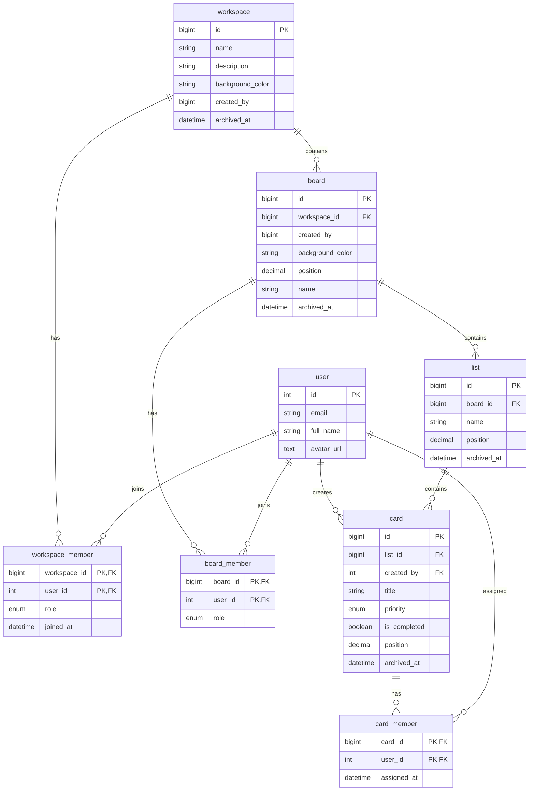

# Database model

The Prisma schema uses MySQL. This diagram reflects the relations currently declared in `prisma/schema.prisma`.

## Verified relations and constraints

- `workspace_member` has a composite primary key of `(workspace_id, user_id)`.
- `workspace_member.workspace_id` references `workspace.id`; deleting a workspace cascades to membership rows.
- `workspace_member.user_id` is an unsigned integer matching `user.id`; deleting a user cascades to membership rows.
- `board.workspace_id` references `workspace.id`; deleting a workspace cascades to its boards.
- `board_member.board_id` references `board.id`; `board_member.user_id` references `user.id`.
- `list.board_id` references `board.id`; deleting a board cascades to its lists and board memberships.
- `card.list_id` references `list.id`; `card.created_by` references `user.id`.
- `card_member.card_id` references `card.id`; `card_member.user_id` references `user.id`.
- `CardPriority` supports `LOW`, `MEDIUM`, `HIGH`, and `URGENT`, defaulting to `MEDIUM`.
- `workspace.created_by` and `board.created_by` are indexed/stored scalar fields, not Prisma relations to `user` in the current schema. `card.created_by` is an unsigned integer relation to `user.id`.
- Workspace and board archive timestamps are nullable. Workspace listing filters out archived workspaces and counts only active boards accessible to the current user.

## Workspace listing

`getAccessibleWorkspaces` returns active workspaces created by the current user, linked through `workspace_member`, or containing boards the user can access through `board_member`. It returns only the active boards the user can access, uses encrypted IDs in client-facing links, and includes the user's workspace role and board/member counts. A creator is treated as an admin even if no separate membership row exists.

The workspace list returns each active workspace and its accessible active boards. Client-facing board links expose only randomized encrypted board tokens, not database board IDs. Board detail reads and list/card creation or reorder actions decrypt the token on the server and independently verify that the authenticated user created the board, is a board member, or belongs to its workspace. Boards are ordered by `created_at`, then `id`; lists and cards are ordered by `position`, then `id`. List and card creation append after the last active record using `position + 1000`. Card reorder validates the complete set of active card IDs for the target list and writes their positions transactionally.

Creating a board verifies workspace access inside a Prisma transaction, assigns the board to the workspace, and records it as created by the authenticated user. Board display order is based on its creation time.

New workspaces store a validated preset hex color in `workspace.background_color`. New boards store a validated selected color. Workspace creation runs in a transaction, writes an ADMIN membership for the authenticated user, and returns only an encrypted workspace identifier. Lists and cards are created at the next active position (`last position + 1000`, or `1000` for the first item).
