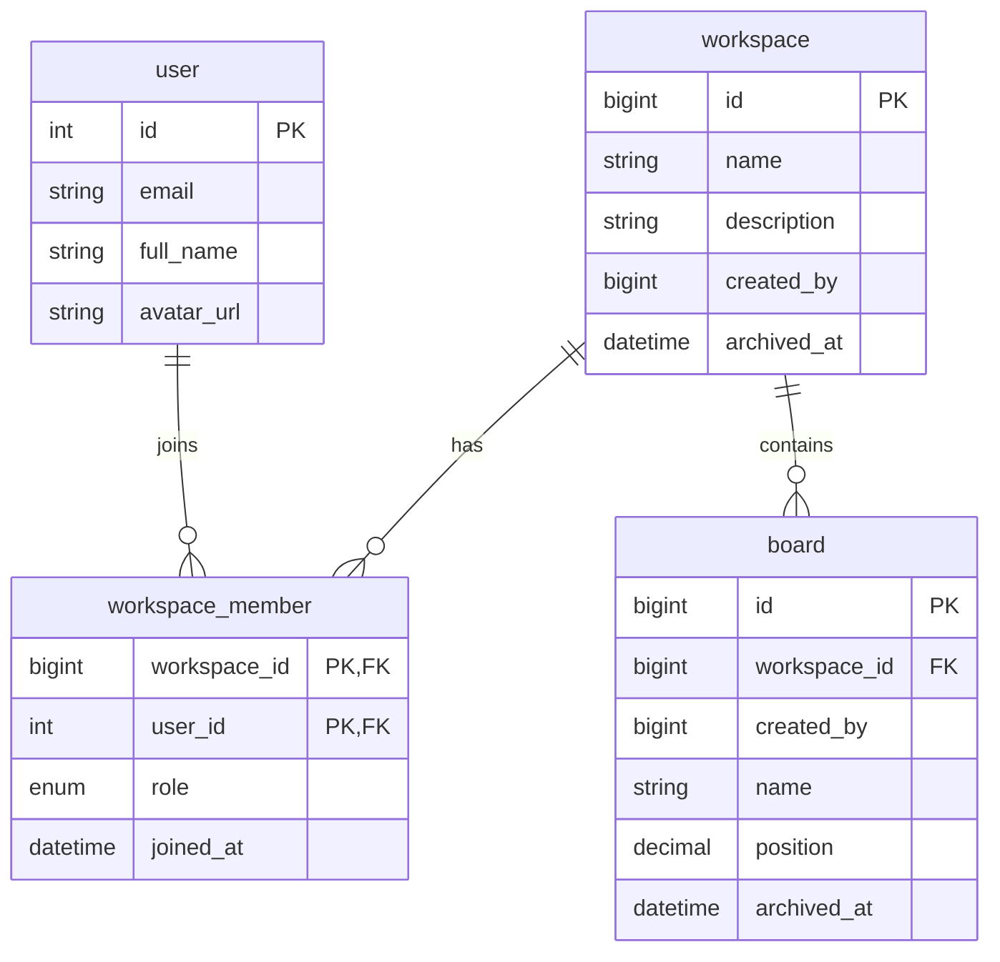

# Database model

The Prisma schema uses MySQL. This diagram reflects the relations currently declared in `prisma/schema.prisma`.

## Verified relations and constraints

- `workspace_member` has a composite primary key of `(workspace_id, user_id)`.
- `workspace_member.workspace_id` references `workspace.id`; deleting a workspace cascades to membership rows.
- `workspace_member.user_id` is an unsigned integer matching `user.id`; deleting a user cascades to membership rows.
- `board.workspace_id` references `workspace.id`; deleting a workspace cascades to its boards.
- `workspace.created_by` and `board.created_by` are indexed/stored scalar fields, not Prisma relations to `user` in the current schema. Do not assume referential integrity for these creator fields.
- Workspace and board archive timestamps are nullable. Current workspace listing filters out archived workspaces; its board count includes boards regardless of their archive timestamp.

## Workspace listing

`findWorkspacesByUserId` returns active workspaces either created by the requested user or linked through `workspace_member`. It maps database `BigInt` IDs to strings before returning them to client UI and includes board/member counts and the user's membership role. A creator is treated as an admin even if no separate membership row exists.

Workspace cards expose only a randomized encrypted URL token, not the database workspace ID. Detail reads and board-order updates decrypt the token on the server and independently require that the mock user owns the workspace or has a membership row. Active boards are ordered by `position`, then `id`; reorder writes assign positions in increments of 1000 within one transaction.

Creating a board also verifies workspace access and reads the last active board's position inside the same Prisma transaction. The new board receives the next position (`last position + 1000`, or `1000` for the first board), is assigned to the workspace, and is recorded as created by the server-side mock user.
