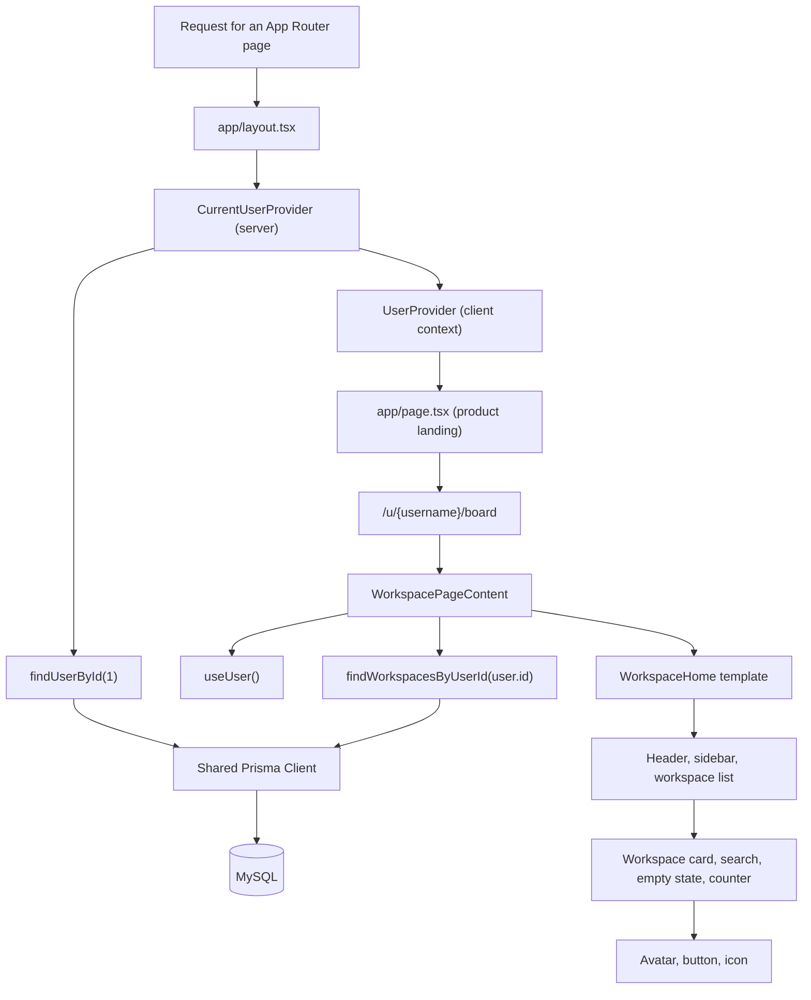
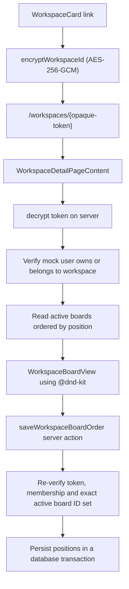

# Architecture overview

## Stack

- Next.js 16 App Router with React 19 and TypeScript.
- Tailwind CSS 4 for styling.
- MySQL accessed through Prisma 7 and `@prisma/adapter-mariadb`.
- Prisma schema: `prisma/schema.prisma`; generated client: `generated/prisma/`.

## Module boundaries

```text
app/
├── page.tsx                    Product landing page
├── layout.tsx                  Root document and provider boundary
├── actions/                    Server actions for data access
├── providers/                  Shared server/client React context
├── features/                   Route-level feature state and orchestration
├── types/                      Shared serializable application data contracts
├── u/[username]/board/          Current user's workspace list
├── workspaces/[workspaceId]/   Workspace detail route with opaque ID param
└── components/
    ├── atoms/                  UI primitives
    ├── molecules/              Small compositions of atoms
    ├── organisms/              Feature-level UI sections
    └── templates/              Page layouts composed from organisms
lib/
└── prisma.ts                   Shared Prisma Client and MariaDB adapter
utils/
├── workspace-id.ts             AES-256-GCM opaque workspace identifiers
└── workspace-background.ts     Board background presentation helper
prisma/
└── schema.prisma               MySQL data model
```

The component dependency direction is one-way: atoms may not depend on higher layers; molecules compose atoms; organisms compose atoms and molecules; templates compose lower layers. Feature orchestration lives outside the visual component hierarchy.

## Current request and workspace flow



The current-user provider awaits `connection()` before its request-time database lookup and is rendered beneath a root-layout `Suspense` boundary. The provider serializes a small user projection into the client context. Workspace records are requested by the client-side feature orchestrator through a server action; only mapped, serializable workspace data is passed to the UI.

### Workspace detail and board ordering



The encryption key is `WORKSPACE_ID_ENCRYPTION_KEY` (64 hexadecimal characters). The same secret must be configured across all instances and deployments. AES-GCM tokens are randomized, authenticated opaque identifiers; they do not authorize access. Current authorization uses the server-side mock user ID `1`.

## Error and loading states

- The root layout provides a neutral suspense fallback while the request-time user lookup runs.
- The workspace feature displays a skeleton while workspaces load.
- A missing mock user has a not-found state; a failed workspace query has a distinct error state with retry.
- A successful query returning no workspaces displays the empty state.

## Infrastructure

`lib/prisma.ts` creates one shared Prisma Client using the MariaDB adapter and `DATABASE_URL`. Keep database credentials and client imports server-side. See [data-model.md](./data-model.md) for the verified schema relationships.
